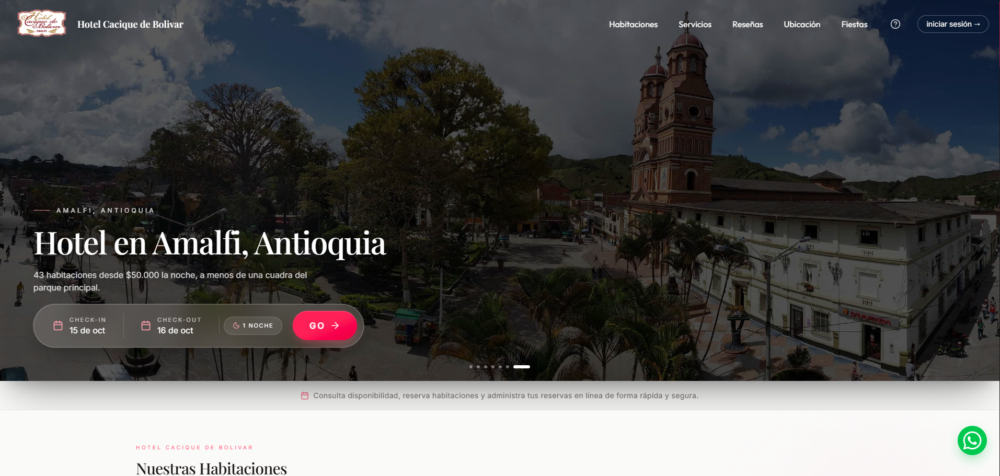
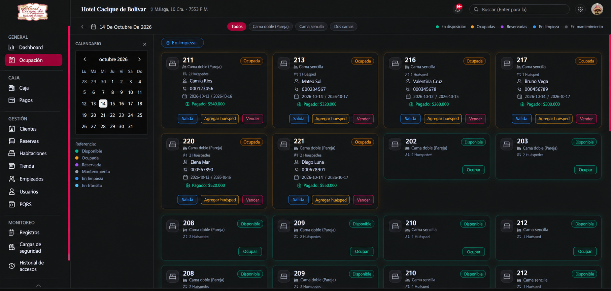
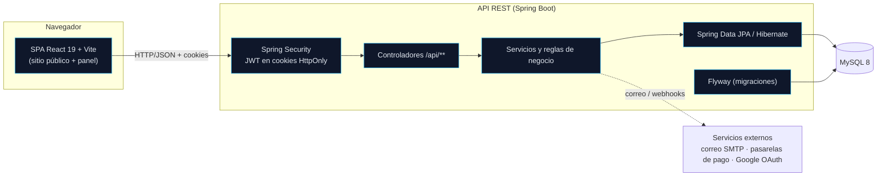
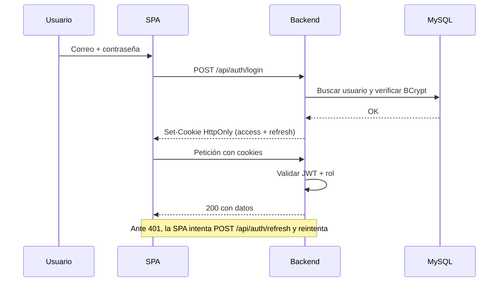

# Hotel Cacique Bolívar — Sistema de gestión hotelera

Monorepo de una aplicación full-stack para la operación de un hotel: reservas,
disponibilidad, caja, tienda de consumos, pagos, huéspedes, empleados, PQRS y
tableros de administración, más un sitio público de reservas.

> **Demostración pública.** Este repositorio es una vitrina técnica para
> portafolio. Todos los datos personales y de contacto han sido sustituidos por
> valores ficticios, no se incluye información real de clientes y no se
> distribuyen credenciales. Ver [`SECURITY.md`](./SECURITY.md).

---

## Tabla de contenido

- [¿Qué es?](#qué-es)
- [Capturas](#capturas)
- [Arquitectura](#arquitectura)
- [Tecnologías](#tecnologías)
- [Estructura del repositorio](#estructura-del-repositorio)
- [Requisitos](#requisitos)
- [Inicio rápido](#inicio-rápido)
- [Variables de entorno](#variables-de-entorno)
- [Datos de demostración](#datos-de-demostración)
- [Pruebas y verificación](#pruebas-y-verificación)
- [API REST](#api-rest)
- [Flujo de autenticación](#flujo-de-autenticación)
- [Decisiones técnicas](#decisiones-técnicas)
- [Limitaciones conocidas](#limitaciones-conocidas)
- [Seguridad y licencia](#seguridad-y-licencia)

---

## ¿Qué es?

Un sistema para administrar un hotel pequeño/mediano con dos experiencias:

**Sitio público** (`/`)

- Página corporativa con galería, ubicación y WhatsApp.
- Consulta de disponibilidad por fechas y número de huéspedes.
- Flujo de **reserva en línea** con registro de huésped y pago del anticipo.
- Página de "mis reservas" para el cliente autenticado.
- Reseñas, PQRS, ayuda, términos y privacidad.

**Panel operativo** (`/dashboard`, staff)

- Reservas (crear, editar, check-in / check-out, bloqueos).
- Mapa de **disponibilidad** y ocupación por fechas.
- **Caja / turnos** con apertura y cierre, arqueo de movimientos.
- **Tienda** de consumos por reserva y desglose de pagos.
- Huéspedes/clientes, empleados, usuarios y permisos.
- **Pagos** y configuración de pasarelas.
- PQRS, alertas y notificaciones en tiempo real (SSE).
- Historial de auditoría y **backups** de base de datos.
- Tableros y reportes.

El control de acceso se resuelve con tres roles: `ADMIN`, `RECEPCIONISTA` y
`CLIENTE`.

---

## Capturas

**Sitio público**



**Panel operativo**



> Capturas tomadas con datos de demostración. El backend siembra habitaciones y
> tipos de habitación de ejemplo, así que la página pública y el panel son
> navegables de inmediato tras el [inicio rápido](#inicio-rápido).

---

## Arquitectura

Aplicación de tres capas desplegada como dos servicios independientes
(backend stateless + frontend SPA) sobre una base de datos MySQL.



**Ideas clave**

- **Backend stateless**: la sesión no se guarda en el servidor. Los JWT viajan en
  cookies `HttpOnly` y se validan en cada petición.
- **El contrato de la API manda**: SpringDoc genera OpenAPI y **Orval** genera el
  cliente TypeScript del frontend a partir de él. Una sola fuente de verdad para
  los tipos.
- **Migraciones versionadas**: Flyway gestiona el esquema (`V1…V10`); Hibernate
  valida, no crea el esquema.
- **Separación por perfil**: `dev` (H2/Swagger/cookies inseguras de desarrollo) y
  `prod` (MySQL, validación estricta de secretos al arrancar).

Detalle en [`docs/ARCHITECTURE.md`](./docs/ARCHITECTURE.md).

---

## Tecnologías

| Capa | Tecnología |
|---|---|
| Backend | Java 21 (probado en JDK 25), Spring Boot 4.0.6, Spring Security, Spring Data JPA / Hibernate, Flyway, MapStruct, Lombok, Maven Wrapper |
| Base de datos | MySQL 8 (H2 en memoria para pruebas) |
| Autenticación | JWT (JJWT) en cookies `HttpOnly`, BCrypt, OAuth Google (opcional) |
| API / contrato | SpringDoc OpenAPI + Orval |
| Frontend | React 19, TypeScript 5.9, Vite 7, Tailwind CSS v4, TanStack Query, React Router, React Hook Form + Zod, Recharts, Radix UI |
| Frontend tooling | pnpm, ESLint, Orval, prerender estático para rutas públicas |
| CI | GitHub Actions (build + tests; sin despliegue) |

---

## Estructura del repositorio

```
hotel-cacique-bolivar/
├─ backend/                     # API REST (Spring Boot)
│  ├─ src/main/java/…           # controladores, servicios, entidades, seguridad
│  ├─ src/main/resources/
│  │  ├─ db/migration/          # migraciones Flyway (V1…V10)
│  │  └─ data/                  # datos públicos (p. ej. municipios DANE)
│  ├─ src/test/                 # pruebas unitarias y de contexto (H2)
│  ├─ docs/                     # runbook de backups, plan de pasarelas
│  └─ .env.example              # plantilla de variables (sin secretos)
├─ frontend/                    # SPA React
│  ├─ src/app/                  # enrutado y providers
│  ├─ src/features/             # 26 módulos funcionales
│  ├─ src/api/generated/        # cliente Orval generado desde OpenAPI
│  └─ .env.example              # plantilla de variables del frontend
├─ docs/                        # documentación del monorepo
├─ .github/workflows/ci.yml     # CI (build + tests)
├─ docker-compose.yml           # MySQL local de desarrollo
├─ SECURITY.md
├─ LICENSE
└─ README.md
```

---

## Requisitos

| Herramienta | Versión | Notas |
|---|---|---|
| JDK | 21 o superior | El `pom.xml` compila con `release 21`. Verificado con JDK 25. |
| Maven | — | Se usa el **Maven Wrapper** (`mvnw`), no hace falta instalarlo. |
| Node.js | 22 o superior | Verificado con Node 24. |
| pnpm | 9 o superior | Verificado con pnpm 11. |
| MySQL | 8 | Opcional si usas Docker. |
| Docker | opcional | Solo para levantar MySQL con `docker-compose.yml`. |

---

## Inicio rápido

### 1. Base de datos (Docker)

```bash
docker compose up -d
```

Esto levanta MySQL en `localhost:3306` con la base `hotelcaciquebolivar` y
credenciales de ejemplo. Si ya tienes un MySQL propio, ajusta las variables de
entorno del backend en lugar de usar Docker.

### 2. Backend

```bash
cd backend
cp .env.example .env          # Windows: Copy-Item .env.example .env
./mvnw spring-boot:run        # Windows: .\mvnw.cmd spring-boot:run
```

El backend arranca en `http://localhost:8080`. Al iniciar:

- aplica las migraciones Flyway,
- crea el usuario administrador con las credenciales de tu `.env`,
- siembra tipos de habitación y habitaciones de ejemplo.

Documentación interactiva de la API: <http://localhost:8080/swagger-ui/index.html>.

### 3. Frontend

```bash
cd frontend
cp .env.example .env          # Windows: Copy-Item .env.example .env
pnpm install
pnpm dev
```

El frontend arranca en `http://localhost:5173`. Por defecto apunta a
`http://localhost:8080`, así que no necesitas configurar nada más.

Inicia sesión en `/hotel/login` con el correo y la contraseña que definiste como
`ADMIN_EMAIL` / `ADMIN_PASSWORD` en el `.env` del backend. El sitio público abre
el inicio de sesión de clientes en un modal desde la barra de navegación.

---

## Variables de entorno

No se versiona ningún secreto. Cada módulo tiene su plantilla:

- `backend/.env.example` → `backend/.env`
- `frontend/.env.example` → `frontend/.env`

Puntos a tener en cuenta:

- `JWT_SECRET` debe ser **Base64 de al menos 32 bytes**. La plantilla incluye un
  valor **de demostración** que debes reemplazar por uno propio en cualquier uso
  real.
- `MIGRACION_CLIENTES_AUTO=false`: la importación masiva de clientes desde CSV
  está desactivada. Esa función requiere un archivo de datos que **no** forma
  parte de esta demostración.
- Las credenciales de correo (`MAIL_*`), pasarelas (`WOMPI_*`, `BOLD_*`) y Google
  OAuth (`VITE_GOOGLE_CLIENT_ID`) son **opcionales**. Sin ellas el sistema
  arranca; esas integraciones quedan simplemente inactivas.
- `CORS_ALLOWED_ORIGINS` controla los orígenes permitidos (por defecto, solo el
  frontend local de Vite).

---

## Datos de demostración

La aplicación **no incluye ningún dato real**. Al arrancar con la configuración de
ejemplo se crean datos ficticios para que la demo sea navegable:

- un usuario administrador (credenciales de tu `.env`),
- tipos de habitación y habitaciones de ejemplo,
- catálogo de municipios (dato público del DANE).

Las tablas de clientes, reservas, pagos y empleados empiezan **vacías**: se
pueblan a medida que usas la aplicación. Esto es intencional —no se distribuyen
datos de terceros— y se explica en [`docs/DEMO.md`](./docs/DEMO.md).

---

## Pruebas y verificación

Verificación ejecutada sobre este árbol de trabajo:

| Componente | Comando | Resultado |
|---|---|---|
| Backend | `./mvnw -B -ntp clean test` | **165 pruebas, 0 fallos, 0 errores** (H2, perfil `test`) |
| Frontend (lint) | `pnpm lint` | **OK** (0 errores) |
| Frontend (build) | `pnpm install --frozen-lockfile && pnpm build` | **OK** (`tsc -b` + `vite build` + prerender) |

El backend cubre entidades de dominio, cálculo de precios y anticipos, desglose
de pagos, importación/backups y el contexto Spring completo. El frontend valida
tipos, compila, pre-renderiza las rutas públicas y pasa ESLint sin errores.

CI (`.github/workflows/ci.yml`) reproduce ambas verificaciones en cada push y PR a
`main`. **No hay jobs de despliegue.**

---

## API REST

Prefijos principales (todos bajo `/api`):

| Prefijo | Descripción | Acceso |
|---|---|---|
| `/api/auth` | Login, registro, refresh, logout, recuperación de contraseña | Público / autenticado |
| `/api/public/**` | Disponibilidad, checkout y pagos públicos | Público |
| `/api/reservas` | Gestión de reservas | Staff |
| `/api/reservas/mis-reservas` | Reservas del cliente | Cliente |
| `/api/habitaciones`, `/api/tipos-habitacion` | Inventario y tarifas | Staff / lectura pública |
| `/api/clientes` | Huéspedes | Staff |
| `/api/caja` | Turnos y movimientos | Staff |
| `/api/pagos`, `/api/pagos/desglose` | Pagos y desglose | Staff |
| `/api/empleados`, `/api/users` | Personal y cuentas | Admin |
| `/api/pqrs`, `/api/resenas`, `/api/alertas` | PQRS, reseñas, alertas | Mixto |
| `/api/dashboard` | Métricas y reportes | Staff |
| `/api/audit-logs`, `/api/backups` | Auditoría y respaldos | Admin |
| `/api/sse` | Notificaciones en tiempo real | Autenticado |
| `/api/webhooks` | Webhooks de pasarelas | Público (validado) |

Referencia navegable en Swagger UI (`/swagger-ui/index.html`) y esquema en
`/v3/api-docs`. Resumen ampliado en [`docs/API.md`](./docs/API.md).

---

## Flujo de autenticación



- Las cookies son `HttpOnly` y (en producción) `Secure`; `COOKIE_SECURE=false`
  solo para desarrollo local sobre HTTP.
- CSRF está deshabilitado porque la API es **stateless** y se consume desde el
  mismo origen mediante cookies `SameSite`.
- El perfil `prod` falla al arrancar si falta un secreto crítico
  (`ProdEnvironmentValidator`): *fail-fast* antes que arrancar inseguro.

---

## Decisiones técnicas

- **Cookies `HttpOnly` en lugar de tokens en `localStorage`**: reduce la
  exposición del token ante XSS y permite el mismo modelo para navegador.
- **OpenAPI como contrato**: el frontend no escribe tipos a mano; Orval los
  genera, de modo que un cambio de DTO rompe la compilación en lugar de fallar en
  runtime.
- **Flyway + `ddl-auto=validate`**: el esquema es reproducible y verificable.
- **Perfiles de configuración**: `dev` cómodo, `prod` estricto.
- **Prerender de rutas públicas**: mejora SEO y tiempos de primera pintura para la
  landing y las páginas legales.
- **Códigos de dominio explícitos** (estados de reserva/habitación, desglose de
  pagos) para no dispersar reglas por la UI.

---

## Limitaciones conocidas

- **Sin datos precargados de clientes/reservas**: por seguridad, no se versionan
  datos de terceros.
- **Pagos en modo sandbox/placeholder**: las pasarelas (Wompi/Bold) no están
  configuradas con credenciales reales; el flujo de pago no procesa dinero.
- **Correo deshabilitado** sin credenciales SMTP: los envíos quedan inactivos.
- **Google OAuth opcional**: requiere tu propio `VITE_GOOGLE_CLIENT_ID`.
- **Backups**: el módulo funciona, pero requiere `mysqldump` y una ruta de
  almacenamiento configurada.
- **JDK**: probado en JDK 25; los avisos de APIs deprecadas de bibliotecas no
  afectan al resultado de compilación ni de pruebas.

---

## Seguridad y licencia

- Política de seguridad, datos de demostración y cómo reportar vulnerabilidades:
  [`SECURITY.md`](./SECURITY.md).
- Guía de la demo paso a paso: [`docs/DEMO.md`](./docs/DEMO.md).
- Guía de desarrollo: [`docs/DEVELOPMENT.md`](./docs/DEVELOPMENT.md).

**Licencia propietaria — todos los derechos reservados.** Se publica con fines de
demostración y portafolio; no se concede licencia de uso. Ver [`LICENSE`](./LICENSE).
