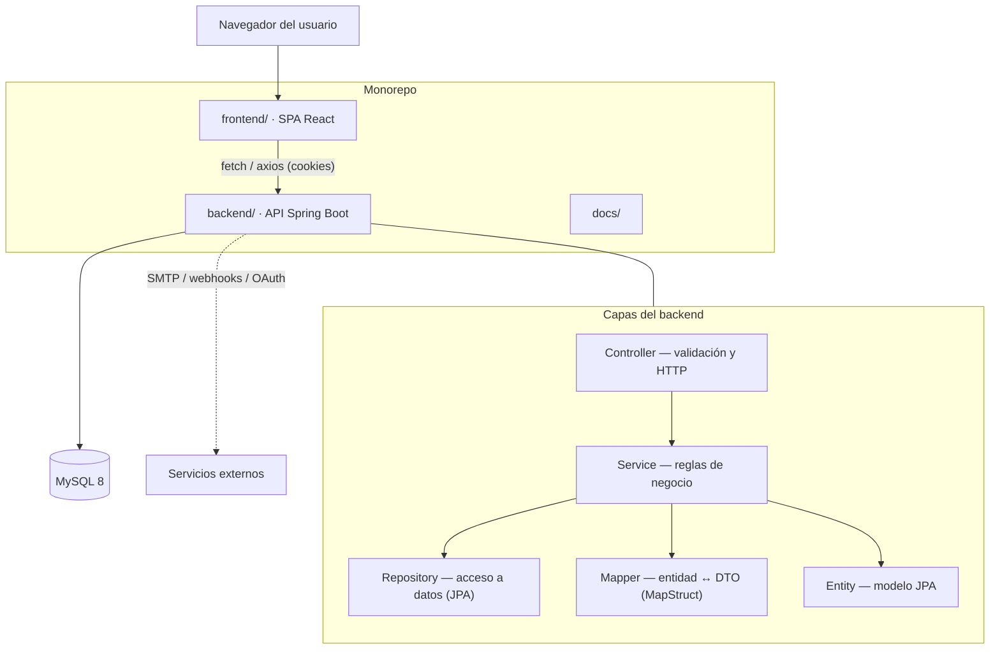
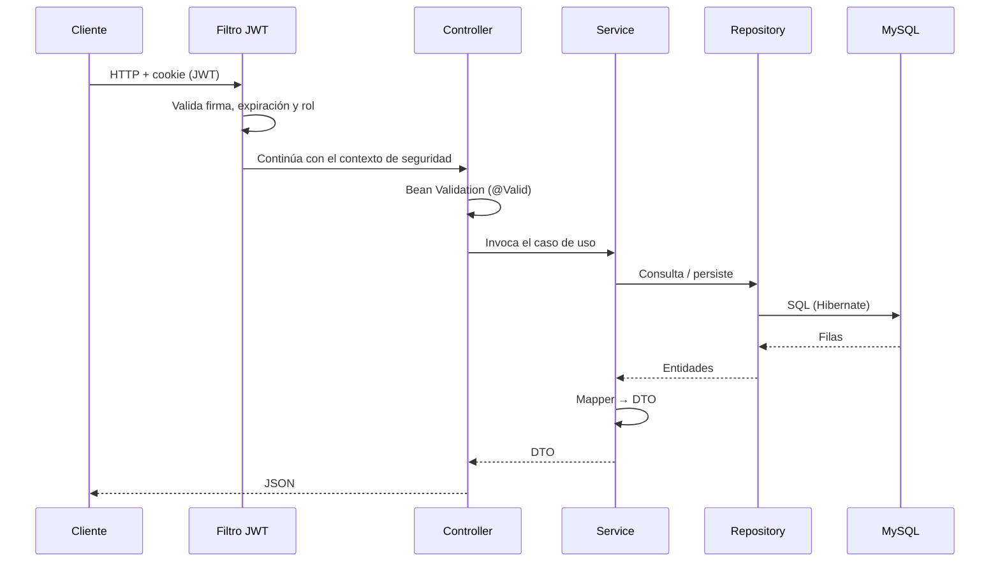
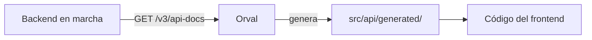

# Arquitectura

Documento técnico del sistema **Hotel Cacique Bolívar**. Describe cómo está
organizado el código, cómo fluyen las peticiones y por qué se tomaron ciertas
decisiones.

---

## 1. Visión general

Dos servicios desacoplados que se comunican por HTTP/JSON:

- **Backend** — API REST en Spring Boot (Java). *Stateless*: no conserva sesiones
  en memoria ni en disco; cada petición se autentica y autoriza con un JWT.
- **Frontend** — SPA en React que sirve tanto el sitio público como el panel de
  administración, según la ruta.

La base de datos es **MySQL 8** en ejecución normal e **H2 en memoria** en
pruebas. El esquema se versiona con **Flyway**; Hibernate únicamente valida.



---

## 2. Backend

### 2.1 Organización de paquetes

Paquete raíz: `com.hotelcaciquebolivar.reservas`.

```
config/        Seguridad, CORS, OpenAPI, inicializadores, perfil, rate limit
controller/    Endpoints REST agrupados por dominio (+ subpaquetes)
service/       Lógica de negocio y orquestación
repository/    Interfaces Spring Data JPA
entity/        Modelo JPA (reserva, habitacion, auth, pago, caja, …)
mapper/        MapStruct: entidad ↔ DTO
dto/           Objetos de transferencia (request/response)
exception/     Excepciones de dominio y manejador global (@RestControllerAdvice)
security/      Filtros JWT, UserDetails, utilidades de token
mail/, sse/,   Integraciones: correo, eventos en tiempo real, backups,
backup/, …     pagos, migración de datos
```

### 2.2 Flujo de una petición



### 2.3 Seguridad

- **Autenticación**: `POST /api/auth/login` verifica la contraseña con **BCrypt**
  y emite un **access token** y un **refresh token** como cookies `HttpOnly`.
- **Autorización**: las rutas se protegen por rol en `SecurityConfig`
  (`ADMIN`, `RECEPCIONISTA`, `CLIENTE`). El cliente solo ve `/api/reservas/mis-reservas`
  y sus propios recursos.
- **Sesión stateless**: `SessionCreationPolicy.STATELESS`, CSRF deshabilitado.
- **Limitación de tasa**: `RateLimitFilter` mitiga abuso en endpoints sensibles.
- **Fail-fast en producción**: `ProdEnvironmentValidator` impide el arranque si
  falta `JWT_SECRET` u otros secretos críticos.
- **CORS**: lista de orígenes explícita y configurable.

### 2.4 Persistencia y migraciones

- `src/main/resources/db/migration/V1…V10__*.sql` definen el esquema.
- `ddl-auto=validate`: si el modelo no coincide con el esquema, la aplicación no
  arranca.
- Entidades con índices y restricciones; auditoría en `audit_logs`.

### 2.5 Inicializadores de datos

Se ejecutan al arrancar y son idempotentes:

| Inicializador | Qué hace |
|---|---|
| `AdminDataInitializer` | Crea el usuario administrador desde `ADMIN_*`. |
| `HabitacionDataInitializer` | Siembra tipos de habitación y habitaciones de ejemplo. |
| `MunicipioDataInitializer` | Carga el catálogo público de municipios (DANE). |
| `MigracionClientesInitializer` | Importación CSV **desactivada** en la demo. |

---

## 3. Frontend

### 3.1 Organización

```
src/app/          Providers (auth, query), enrutado y layouts
src/api/          Cliente HTTP, interceptores y cliente generado por Orval
src/features/     26 módulos funcionales (reservas, caja, clientes, …)
src/components/   UI reutilizable (shadcn/ui) y utilidades
src/config/       Configuración de dominio (datos del hotel, etc.)
src/hooks/        Hooks compartidos
src/styles/       Tailwind v4 y tema
```

### 3.2 Enrutado

Tres bloques de rutas bien separados:

- **Público** (`public.routes.tsx`): landing, reservar, ayuda, legales, mis
  reservas.
- **Autenticación** (`auth-*`): login de staff en `/hotel/login` y login de
  cliente en un modal del sitio público.
- **Dashboard** (`dashboard/*.routes.tsx`): panel operativo, uno por dominio.

`ProtectedRoute` valida sesión y rol antes de renderizar el panel.

### 3.3 Datos y estado

- **TanStack Query** para caché, reintentos e invalidación.
- **React Hook Form + Zod** para formularios y validación declarativa.
- **Axios** con interceptores que añaden credenciales y manejan el refresco de
  token ante un `401`.
- **SSE** (`/api/sse`) para notificaciones en tiempo real.

### 3.4 Contrato de API

El cliente TypeScript de `src/api/generated/` lo produce **Orval** a partir del
OpenAPI del backend. Flujo:



Así, un cambio en un DTO del backend se refleja en tipos que el compilador de
TypeScript verifica.

---

## 4. Perfiles de configuración

| Perfil | Base de datos | Swagger | Cookies `Secure` | Uso |
|---|---|---|---|---|
| `dev` | MySQL (o H2) | Habilitado | No | Desarrollo local |
| `prod` | MySQL | Deshabilitado | Sí | Producción |
| `test` | H2 en memoria | — | — | Pruebas automatizadas |

Los valores sensibles se inyectan por variables de entorno; los `application-*.yml`
solo contienen marcadores `${VAR}`.

---

## 5. Decisiones de diseño

| Decisión | Motivo |
|---|---|
| JWT en cookies `HttpOnly` | Mitiga robo de token vía XSS frente a `localStorage`. |
| Stateless + CSRF off | API consumida por SPA con `SameSite`; simplifica el modelo de sesión. |
| OpenAPI → Orval | Tipos únicos y verificados por compilador; menos errores de integración. |
| Flyway + `validate` | Esquema reproducible y auditable. |
| Mappers MapStruct | Separación entidad/DTO sin reflexión en runtime. |
| Perfiles estrictos en prod | Fallar al arrancar antes que arrancar inseguro. |
| Prerender del sitio público | SEO y primera pintura para páginas que deben indexarse. |
